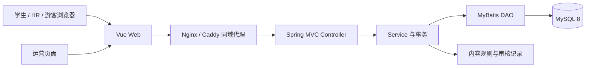

# 《CareerQ》技术方案与架构设计

> 对外名称：职问桥　｜　更新日期：2026-11-20　｜　状态：当前工程基线
> 配套：[产品策划书](项目策划书-CareerQ.md)、[接口契约](接口契约-职问桥.md)、[实施计划](实施计划-职问桥.md)

## 1. 当前目标与交付范围

项目提供公开、异步的职业问答。游客浏览已发布的问题和回答，学生提问与追问，HR 回答主问题或指定学生追问，运营审核内容并处理举报。所有角色使用同一 Web 工程，通过独立页面入口和后端授权区分职责。

| 能力 | 实现方式 | 当前状态 |
|---|---|---|
| 公开问答浏览 | Feed、问题详情、回答时间线 | 已实现 |
| 搜索、标签、时间筛选与排序 | 同一 Feed 查询契约；推荐、最新、热门 | 已实现 |
| 学生提问与追问 | 问题、标签与追问 API；作者归属校验 | 已实现 |
| HR 工作台 | 待回答、已回答公开问题、我回答过的三类列表 | 已实现 |
| HR 回复追问 | 回答保存 `followup_id`，明确关联原学生追问 | 已实现 |
| 互动与举报 | 点赞、收藏、有用、不感兴趣；举报处理接口 | 已实现 |
| 内容审核 | 词库、内置规则、人工审核和审核记录 | 后端已实现；运营页面待完善 |
| HR 原创职业观点帖 | 独立帖子模型、发布与审核、公开展示和互动 | 待开发，不能视为已有功能 |
| 真实短信和 HR 认证 | 外部验证码供应商、身份资料验证 | 暂缓；演示使用固定验证码和测试账号 |
| 真实消息通知 | 新回答、新追问与审核结果提醒 | 待开发；当前学生消息面板为示例 |

HR 不创建学生问题、不发起学生追问、不审核。运营不提问、不回答，专注内容审核和举报。公开追问与 HR 的定向回复属于问答链路，不构成独立聊天功能。

## 2. 技术选型

| 层 | 当前选型 | 使用方式 |
|---|---|---|
| 前端 | Vue 3、TypeScript、Vite | 响应式页面、统一请求层、角色路由 |
| 状态与组件 | Pinia、Vue Router、Naive UI、Tailwind CSS | 会话状态、页面导航与公共展示组件 |
| 后端 | Spring Boot 3、Java 21、Spring MVC | 模块化单体，Controller → Service → DAO |
| 持久层 | MyBatis、Spring 事务 | 参数化 SQL、对象映射和事务一致性 |
| 数据库 | MySQL 8；本地 H2 MySQL 兼容模式 | `prod` 与默认 `dev` profile 分离 |
| 数据库迁移 | Flyway | 启动执行版本迁移；已有 V1–V9 不可改写，后续变更追加新版本 |
| 契约 | springdoc OpenAPI | 运行时 `/v3/api-docs` 与仓库 `docs/openapi.json` |
| 部署 | 前端静态资源 + Nginx/Caddy + Java 服务 | 生产建议同域 HTTPS 反向代理 |

当前工程不依赖 Redis、消息队列、外部搜索服务或大模型服务即可启动。后续引入这些依赖前，应有明确的性能或产品需求。

## 3. 工程结构与职责

```text
frontend/src/
  views/             公开问答、学生页面、HR 工作台
  components/        卡片、筛选、标签、资料与消息展示
  api/               业务 API 与统一请求层
  stores/            用户会话状态
backend/shared.all/product.shared/
  product.api/       Controller、参数校验、API 异常处理
  product.service/   服务接口、DTO、统一响应、登录主体
  product.service.impl/
    src/main/java/   Service 实现、DO、MyBatis DAO、配置和启动类
    src/main/resources/db/migration/   Flyway 历史迁移
    src/test/java/   业务流程、权限和数据访问测试
```

前端通过公开 API 交换 DTO，不依赖 DAO、实体或表结构。后端跨模块的字段、状态与权限变化需要更新接口契约，并由受影响模块负责人协同审查。

## 4. 运行架构



本地开发由 Vite 代理 `/api`。`CAREERQ_API_PROXY_TARGET` 可指定后端目标，默认 `http://localhost:8080`。前端在 5173 或 5176 运行时，应保持代理和 CORS 来源配置一致，避免浏览器 POST 被来源校验拒绝。

## 5. 数据边界

| 数据 | 核心关系与职责 |
|---|---|
| `users`、`hr_profiles` | 账号角色、匿名展示名与 HR 资料 |
| `questions`、`tags`、`question_tags` | 公开问题、发布状态、计数和标签 |
| `answers` | HR 回答；`followup_id` 为空为主问题回答，非空为指定追问回复 |
| `followups` | 学生在公开问题下提交的追问 |
| `interactions` | 当前用户对问题/回答的互动；唯一键保证同一互动不重复计数 |
| `user_tag_affinity` | 可由互动事实重建的用户标签偏好缓存 |
| `reports` | 举报目标、原因、状态和处理结果 |
| `moderation_words`、`moderation_records` | 规则配置、机器与人工审核记录 |

当前业务只接受 `scope=public`。历史迁移可能保留已停用的存储结构，它们不构成现行 API 或产品功能；不为删除旧功能而改写已执行的 Flyway 脚本，也不自动清除已有数据库数据。

HR 原创观点帖尚未有可用的独立发布链路。后续开发需要新建帖子契约与迁移，不能把已移除的旧内容结构当作观点帖实现。

## 6. 公开问答与 HR 流程

1. 学生提交问题。普通内容直接发布，命中审核规则的内容进入人工审核或拒绝状态。
2. 公开 Feed 只返回已发布内容。问题作者通过自己的列表查看允许展示的审核状态。
3. HR 待回答池排除已有已发布或审核中回答的问题，避免重复集中作答。
4. HR 回答主问题，或选择一条已发布学生追问进行回复；后端校验问题与追问关系、角色和内容状态。
5. 回答经过审核，通过后才增加公开回答数。提交者可以在本人回答记录中查看相应状态。
6. 学生查看回答、提交追问并互动；运营通过队列和举报接口处理内容风险。

问题、回答和追问的撤回/撤销以各服务的作者与状态校验为准。回答下架后的计数一致性、撤回与下架文案区分、新追问提醒属于后续收尾项，不能仅凭按钮或静态页面算完成。

## 7. 接口和分页

- 统一响应为 `{code, message, data}`；错误码和响应字段以[接口契约](接口契约-职问桥.md)与运行时 OpenAPI 为准。
- HR 列表和普通列表使用 ID 游标，`nextCursor=null` 表示末页。HR 工作台每页 5 条，末页禁用下一页。
- 推荐 Feed 使用不透明字符串游标，绑定排序与筛选条件；切换条件必须从第一页重新请求。
- Feed 支持搜索词、标签、时间范围和推荐/最新/热门排序；详见[Feed 推荐流方案](技术方案-Feed推荐流.md)。
- 写请求由统一请求层携带 Cookie 和 CSRF 令牌。前端需要防重复提交；通用 `Idempotency-Key` 尚未强制实现。

## 8. 鉴权与内容可见性

- 会话采用服务端 Session + HttpOnly Cookie。生产使用 HTTPS 与 Secure Cookie，浏览器不把长期会话令牌存入 localStorage。
- 后端使用角色和对象归属授权，隐藏菜单不能替代授权；学生、HR、运营互不能调用对方的业务写接口。
- 内容写接口校验 CSRF，CORS 使用明确来源白名单。认证接口的具体 CSRF 配置以 `SecurityConfig` 为准。
- 公开读接口只返回已发布内容；作者可查看自己有权查看的审核内容，运营从审核接口读取上下文。
- 真实身份资料与公开展示分开，手机号、验证码、Cookie 和认证材料不得进入公开返回或明文日志。

## 9. 审核与举报

当前机器审核是词库与内置规则，不是已接入的大模型。`block` 规则拒绝内容，`review` 规则进入人工队列，其余内容可直接发布。运营角色负责通过、驳回、下架与举报处理，管理员另有词库维护权限。

后续可评估外部内容安全服务、真实风险分级、申诉、批量审核和消息通知。引入前需要增加可验证的契约、日志和失败处理，不能只在文档中声明已完成。

## 10. 团队边界与交付

| 模块 | 负责人 | 交付边界 |
|---|---|---|
| 公开浏览与公共展示 | 王（按团队最终分工） | 游客 Feed、筛选、公开展示组件 |
| 账号与学生提问 | 季（按团队最终分工） | 账号、学生提问、我的问答和学生交互 |
| HR 与运营 | 李（已确认） | HR 工作台、回答与追问回复、后续观点帖、运营审核与举报页面及后端 |

李不直接修改学生端功能。涉及公共导航、共享卡片和跨模块契约时先明确归属，由对应负责人协调；本次仅删除停用业务的必要调用与文档。每项任务在最新 main 上建独立分支，完成适当测试后提交 PR，至少由另一位人类成员审查。

构建、启动和部署方式见 [backend README](../backend/README.md)及[部署说明](部署说明-职问桥.md)。生产 MySQL 验证与备份恢复应在具备目标环境时单独执行，不以本地 H2 测试替代。
