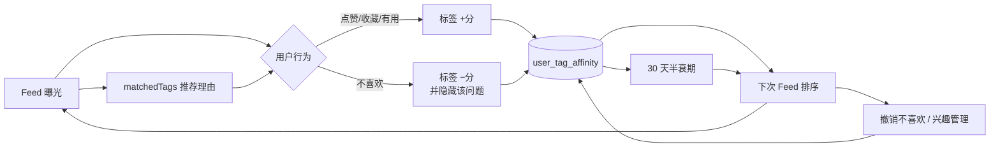

# 《CareerQ》Feed 推荐流方案（标签偏好闭环）

> 状态：**已实施（P0）**　｜　日期：2026-11-17
> 基线：`feature/public-qa-redesign` 分支，表结构 V1–V6
> 关联文档：[`技术方案-CareerQ.md`](技术方案-CareerQ.md)、[`接口契约-职问桥.md`](接口契约-职问桥.md)

---

## 0. 结论先行

1. **不新建推荐系统**：复用现有 `interactions` 作为唯一信号源，新增一张派生表 `user_tag_affinity` 缓存「用户 × 标签」偏好分数。因为标签是 V5 固定目录，每个用户最多几十行。
2. **点赞 / 收藏 / 有用** → 给问题的标签加正分；**取消** → 从 `interactions` 重算（天然处理撤销，不会出现「取消后仍残留偏好」）。
3. **不喜欢** 复用 `interactions` 的 `type='dislike'`：给标签扣分，并把这条问题从该用户的 Feed 中排除；可以撤销。
4. **新接口** `GET /api/v1/feed/questions`：可选登录，返回同款 FeedCard + `matchedTags`（推荐理由）。旧 `GET /api/v1/questions` 保持时间倒序不变。
5. **排序两段式**：近 60 天候选池（≤500 条）→ 标签亲和 + 质量 + 新鲜度 + 确定性探索抖动 → 负向标签过滤 + 多样性 → 稳定分页。不引入 Redis、ES、向量或模型训练。
6. **闭环**：曝光 → 点赞/收藏/不喜欢 → 偏好更新 → 下次排序 → 展示推荐理由 → 用户撤销/减少此类 → 偏好更新；偏好带 30 天半衰期，兴趣会自然漂移。

---

## 1. 现状与约束（基于当前代码）

| 事实 | 位置 | 对方案的影响 |
|---|---|---|
| 公开 Feed 仅 `scope=public AND status=published`，`order by id desc`，支持单个 `tag` 过滤 | `QuestionServiceImpl#list`、`QuestionDao#list` | 推荐需要新的候选查询，但可复用现有状态条件 |
| 点赞/收藏/有用统一写 `interactions`，唯一键 `(user_id,target_type,target_id,type)`，重复点击幂等 | `InteractionServiceImpl#interact` | 不喜欢可直接复用该表与幂等逻辑，无需新表 |
| `interactions.type` 是 `VARCHAR(16)`，无枚举约束 | `V1__init.sql` | `type='dislike'` **不需要改表** |
| 取消点赞/收藏是物理删除 `interactions` 行 | `InteractionServiceImpl#uninteract` | 偏好必须能反映「当前仍存在的互动」，不能只做增量加减 |
| 标签是 V5 固定目录（33 个，含 category/weight），问题通过 `question_tags` 关联 | `V5__fixed_tag_catalog.sql` | 每个用户的偏好行数有上限，适合内存排序 |
| `GET /api/v1/feed/**` 已在安全配置中放行 | `SecurityConfig` | 新接口不需要改安全规则 |
| 分页游标类型固定为 `Long` | `PageResult.java` | 推荐流需要不透明字符串游标，应使用新的返回 DTO，避免改动公共类型 |
| Feed 逐条查标签（N+1） | `QuestionServiceImpl#toFeedItem` | 推荐需要批量查标签，否则排序阶段会放大 N+1 |
| 没有曝光/点击日志 | — | 先做行为数据闭环；曝光与 A/B 放 P1 |

---

## 2. 目标与非目标

### 目标

- 用户点赞或收藏一个问题后，系统记住「他对哪些标签感兴趣」。
- 下一次打开 Feed，相关标签的问题获得更高排序；无偏好时退化为「质量 + 新鲜度」。
- 提供「不喜欢这个内容」：隐藏当前问题，并降低其标签的兴趣分。
- 用户能撤销不喜欢；偏好随时间衰减，不形成永久标签。
- 不改变现有 API 契约、公开计数语义与审核状态机。

### 非目标（本版不做）

- 不做协同过滤、Embedding、语义相似度、在线学习。
- 不做每用户实时预计算 Feed、不做 Redis/ES。
- 不改变 `questions.like_count/favorite_count` 等公开计数。
- 不做 HR 问题池排序（只做学生侧公开 Feed）。
- 不新增自定义标签。

---

## 3. 总体设计



核心原则：**`interactions` 是事实源，`user_tag_affinity` 是可重建的物化缓存。** 任何偏好变化都从当前互动记录重算，避免增量加减与取消操作对不上。

---

## 4. 数据模型

### 4.1 新增表 `user_tag_affinity`（V6）

```sql
-- V6: 用户标签偏好（Feed 推荐派生表，可从 interactions 重建）
CREATE TABLE user_tag_affinity (
    user_id       BIGINT NOT NULL,
    tag_id        BIGINT NOT NULL,
    score         DECIMAL(10,3) NOT NULL DEFAULT 0,
    computed_at   DATETIME NOT NULL,
    created_at    DATETIME NOT NULL,
    updated_at    DATETIME NOT NULL,
    PRIMARY KEY (user_id, tag_id)
);
```

- 不建外键，与现有表保持一致。
- 主键天然覆盖 `user_id` 查询；每用户最多「标签目录数量 + 历史标签」行，无需额外索引。
- `score` 是 `computed_at` 时刻的分数；读取时再按 `computed_at → now` 做时间衰减。
- 保留 0 分行便于调试；Feed 计算时 0 视为中性。

### 4.2 信号权重

| 行为 | targetType | 权重 | 说明 |
|---|---|---:|---|
| 点赞 | `question` | +1.0 | 轻量正反馈 |
| 收藏 | `question` | +3.0 | 强意图，收藏通常代表「以后要用」 |
| 标记有用 | `question` | +1.5 | API 已支持，UI 目前未暴露 |
| 不喜欢 | `question` | −5.0 | 负反馈，同时排除该问题 |
| 点赞回答 | `answer` | +0.5 | **P1**，映射到父问题的标签 |
| 收藏回答 | `answer` | +1.5 | **P1**，映射到父问题的标签 |

- 单个事件对标签的贡献不按标签数摊薄；一个问题有多个标签时，每个标签都得到该权重。
- 用户偏好分数统一裁剪到 `[-20, +20]`，防止单个标签被少数行为刷爆。
- 负反馈与正反馈使用同一半衰期（30 天），避免「一次误点永久拉黑一个标签」。

### 4.3 偏好计算：事件溯源 + 物化缓存

**写入路径（点赞/取消/不喜欢）**

1. 先完成 `interactions` 的插入或删除（沿用现有幂等处理）。
2. 在**同一事务**内，重算该用户所有受影响的标签：
   - 查询该用户当前仍存在的、`target_type='question'` 的互动；
   - join `question_tags` 展开到标签；
   - 按标签求和：`Σ 权重 × 0.5^(事件距今天数 / 30)`；
   - 裁剪到 `[-20, +20]`，upsert 到 `user_tag_affinity`。
3. 取消点赞/收藏后，对应 `interactions` 行已删除，重算结果自然回落；不需要「反向扣分」。

**读取路径（Feed）**

```
aff_now(tag) = clamp(score × 0.5^((now - computed_at) / 30 天), -20, +20)
```

这样即使用户 60 天没有新行为，偏好也会自然衰减，不会让 Feed 长期锁死。

**为什么不做纯增量加减**

`interactions` 取消时是删除行。如果点赞加 1、取消减 1，经过衰减后两者并不抵消（+1 衰减成 +0.25，再减 1 会变成负分）。重算虽然每次多一次查询，但用户互动量有限，换来的是语义正确、可重建、易调试。

**并发**

MVP 并发低。重算 + upsert 使用 `select ... for update`（按 `tag_id` 升序）或捕获唯一键冲突后重试一次。极端并发下最坏是少算一次行为，下一次互动会修正；不引入分布式锁。

### 4.4 不喜欢（dislike）

**存储**：复用 `interactions`，`target_type='question'`，`type='dislike'`。唯一键保证一人一题一条。

**语义**

| 规则 | 行为 |
|---|---|
| 写入 | 标签各 −5 分；该问题从该用户 Feed 永久排除（直到撤销） |
| 撤销 | 删除 `interactions` 行；标签重算回正；问题可重新出现 |
| 与点赞/收藏共存 | 允许共存；**可见性上不喜欢优先**（排除问题），偏好上按净分计算 |
| 公开计数 | 不增加任何公开计数（`questions` 无 dislike_count） |
| 二次点击 | 幂等，不重复扣分 |
| 作用范围 | P0 只支持 `question`；回答/观点帖不支持不喜欢 |

**为什么不新建 dislike 表**：现有幂等、可见性校验、我的收藏分页、唯一索引都可复用；`type` 字段无约束，加一个值即可。

### 4.5 历史数据回填

V6 迁移中一次性回填已有互动，避免老用户从零开始：

```sql
INSERT INTO user_tag_affinity (user_id, tag_id, score, computed_at, created_at, updated_at)
SELECT i.user_id,
       qt.tag_id,
       LEAST(20, GREATEST(-20, SUM(CASE i.type
           WHEN 'favorite' THEN 3
           WHEN 'like' THEN 1
           WHEN 'useful' THEN 1.5
           ELSE 0 END))),
       CURRENT_TIMESTAMP, CURRENT_TIMESTAMP, CURRENT_TIMESTAMP
FROM interactions i
JOIN question_tags qt ON qt.question_id = i.target_id
WHERE i.target_type = 'question'
  AND i.type IN ('like', 'favorite', 'useful')
GROUP BY i.user_id, qt.tag_id;
```

- 回填不做时间衰减（一次性近似值），首次读取或下次互动后自动进入衰减体系。
- 回填后可用 `user_tag_affinity` 与 `interactions` 对账，确认无遗漏。

---

## 5. Feed 召回与排序

### 5.1 候选集

单次请求先取一个有限候选池：

```sql
SELECT q.*
FROM questions q
WHERE q.scope = 'public'
  AND q.status = 'published'
  AND q.id <= #{maxId}                 -- 本次会话的快照上界
  AND q.created_at >= #{since}         -- 默认近 60 天
  AND NOT EXISTS (
      SELECT 1 FROM interactions i
      WHERE i.user_id = #{userId}
        AND i.target_type = 'question'
        AND i.target_id = q.id
        AND i.type = 'dislike'
  )
  AND (#{tag} IS NULL OR EXISTS (      -- 兼容现有单标签筛选
      SELECT 1 FROM question_tags qt JOIN tags t ON t.id = qt.tag_id
      WHERE qt.question_id = q.id AND t.slug = #{tag}
  ))
ORDER BY q.id DESC
LIMIT #{candidateLimit};              -- 默认 500
```

- 候选池上限 500，按 id 倒序取最新窗口；排序在应用层完成。
- 若窗口内结果不足一页，自动放宽 `since`（例如退到 180 天或去掉时间条件），避免空 Feed。
- 标签批量查询：一次 `IN (questionIds)` 取回 `question_id → tags`，替代当前逐条查询。

### 5.2 打分公式

对所有候选计算：

```
A(q) = clamp( Σ aff_now(t), -10, +10 )        // 问题所有标签的亲和之和
Q(q) = tanh( ln(1 + 3*favorite + 2*like + 1.5*reply + useful) / 3 )
R(q) = 0.5^(问题年龄小时数 / 168)             // 7 天半衰期

S(q) = 0.55 * tanh(A / 3) + 0.20 * Q(q) + 0.20 * R(q) + 0.05 * jitter
```

- `reply = answer_count + followup_count`，与 Feed 卡片口径一致。
- `jitter = hash01(seed, questionId) * 0.05`：确定性随机，用于探索，避免排序完全固化。
- 亲和项用 `tanh` 压扁，保证强偏好最多带来约 ±0.55 的分数差，不会把时间/质量信号完全压死。
- 无任何偏好行（新用户/游客）：`S = 0.45*Q + 0.45*R + 0.10*jitter`。
- 可选的轻量降权（默认关闭）：自己提的问题 −0.05；已点赞/已收藏的问题 −0.05，把位置让给新内容。

### 5.3 负向过滤与兜底

- **硬过滤**：问题任一标签的 `aff_now <= -8` → 不进入排序。
  - 一次不喜欢是 −5，不会立刻封杀标签；两次同类不喜欢约 −10，才会排除该标签的内容。
- **显式排除**：被用户 `dislike` 的具体问题始终排除。
- **兜底**：若过滤后候选不足 `2 × limit`，把硬阈值放宽到 −12，仍不足则忽略负向过滤，只保留显式排除。宁可展示，也不要空 Feed。

### 5.4 探索与多样性

- **探索**：通过 5% 的确定性抖动实现（冷启动 10%）。同一 `seed` 下顺序稳定，跨页不会重复/跳过。
- **多样性**：对排好序的完整列表做一次贪心重排，任意连续 3 条不能属于同一 `tags.category`；违反的条目先延后，最后追加。避免一页全是「求职阶段」。
- 这两步都在完整列表上执行，再按页切片，因此分页结果确定。

### 5.5 分页：快照游标

推荐流的排序包含随机抖动和多样性重排，用「上一页最后一条的分数」做游标会跳过条目。MVP 采用**冻结快照 + 页码游标**：

游标明文为 `v1:<快照秒>:<maxId>:<seed>:<页码>`，再做 base64url 编码。例如
`djE6MTc2MzM4MDgwMDoxMDI0MDo5ODc2NTox` 解码后为 `v1:1763380800:10240:98765:1`。

| 字段 | 含义 |
|---|---|
| `v` | 游标版本 |
| `t` | 首次请求的快照时间；新鲜度与偏好衰减都以它为基准 |
| `m` | 快照时的最大问题 id；后续页面只取 `id <= m`，新问题在下一次刷新时出现 |
| `s` | 探索随机种子 |
| `p` | 页码，从 0 开始 |

服务端每次按 `(t, m, s)` 重新计算完整排序，再切 `[p*limit, (p+1)*limit)`。候选 ≤500，单次排序成本可忽略。

- 首页不传 `cursor`，服务端生成 `t/m/s/p=0`；返回 `nextCursor` 为下一页游标，没有更多则为 `null`。
- 最大页深限制为 25 页（500 条），超过返回空页，防止无限翻页。
- 游标解析失败返回 400；游标只影响请求者自己的排序，不需要签名。
- 客户端切换 `tag` 或「最新」Tab 时必须丢弃旧游标。

### 5.6 复杂度

- 偏好读取：≤ 标签数行（通常 ≤33）。
- 候选查询：1 次（≤500 行）。
- 标签批量查询：1 次。
- 排序：`O(n log n)`，n ≤500。
- 每页重复计算一次完整排序，MVP 数据量下远低于 10ms 级开销。

---

## 6. API 设计

### 6.1 `GET /api/v1/feed/questions`

推荐流。可选登录：匿名时按「质量 + 新鲜度」排序，不做个人化。

| 参数 | 说明 |
|---|---|
| `tag` | 可选，沿用现有标签 slug 过滤 |
| `cursor` | 可选，上一页返回的不透明字符串 |
| `limit` | 1–50，默认 20 |

响应：

```json
{
  "items": [
    {
      "id": 1024,
      "title": "秋招简历项目经历怎么写？",
      "excerpt": "……",
      "tags": ["简历", "秋招"],
      "answerCount": 2,
      "followupCount": 1,
      "replyCount": 3,
      "likeCount": 5,
      "favoriteCount": 2,
      "createdAt": "2026-11-16T10:20:00",
      "matchedTags": ["简历"]
    }
  ],
  "nextCursor": "djE6MTc2MzM4MDgwMDoxMDI0MDo5ODc2NTox"
}
```

- `matchedTags`：问题标签中该用户 `aff_now > 0` 的标签，按亲和降序取前 2；无偏好/游客为空数组。前端用它展示「因为你关注「简历」」。
- 返回 DTO 使用新的 `FeedPage(items, String nextCursor)`，不改公共 `PageResult<Long>`。
- `QuestionFeedItem` 增加 `matchedTags` 字段（附加字段，旧 `/questions` 返回空数组），避免复制一份列表 DTO。

### 6.2 不喜欢

复用现有接口，不新增路径：

```http
POST /api/v1/interactions
Content-Type: application/json

{ "targetType": "question", "targetId": 1024, "type": "dislike" }
```

撤销：

```http
DELETE /api/v1/interactions
{ "targetType": "question", "targetId": 1024, "type": "dislike" }
```

- `type` 白名单增加 `dislike`；只允许 `targetType=question`。
- `applyCount` 对 `dislike` 直接返回，不更新任何公开计数。
- 现有 CSRF、登录校验、可见性校验沿用。

### 6.3 `ViewerState` 扩展

```json
{ "liked": false, "usefuled": false, "favorited": false, "disliked": false }
```

`detail` / `content` / `thread` 复用同一个 `viewerState()`，只在查询里多一次 `exists`。前端可据此在详情页显示「已隐藏，不再推荐」。

### 6.4 P1：兴趣管理

| 接口 | 用途 |
|---|---|
| `GET /api/v1/me/preferences` | 查看标签偏好（tag、category、score、lastEventAt），分数取衰减后的值 |
| `DELETE /api/v1/me/preferences` | 重置全部偏好（需要确认） |
| `POST /api/v1/me/preferences/{tagId}/less` | 减少某标签推荐（写入手动偏移） |

重置的语义建议：在 `users` 增加 `affinity_reset_at`（V7），重算时只统计该时间之后的互动。这样「重置」不会被历史互动立刻还原。P1 再做，P0 只提供「不喜欢 + 撤销」。

---

## 7. 后端改造点（文件级）

> 已按此清单落地（P0）。

### 7.1 迁移

- `db/migration/V6__tag_affinity.sql`：新增 `user_tag_affinity` + 回填。
- 不需要修改 `interactions` 表结构（`type` 足够长）。

### 7.2 服务层

| 文件 | 改动 |
|---|---|
| `dao/TagAffinityDao.java`（新） | 按用户查偏好、按 `(user_id, tag_id)` 查询/加锁、upsert |
| `service/TagAffinityService.java`（新） | 重算用户偏好、读取有效亲和、批量计算 |
| `service/impl/TagAffinityServiceImpl.java`（新） | 事件溯源重算 + 30 天衰减 + 裁剪 |
| `service/impl/InteractionServiceImpl.java` | `TYPES` 增加 `dislike`；`requireSupported` 限制 dislike 仅 question；`applyCount` 跳过 dislike；插入/删除成功后调用偏好重算；把解析出的父问题 id 传给重算 |
| `service/impl/QuestionServiceImpl.java` | 新增 `feed(...)`；批量取标签；构造 `matchedTags`；`viewerState` 增加 disliked |
| `service/QuestionService.java` | 新增 `feed` 方法签名 |
| `dao/QuestionDao.java` | 新增 `listFeedCandidates(scope,status,maxId,since,tag,excludeUserId,limit)` |
| `dao/TagDao.java` | 新增 `findTagsByQuestionIds(List<Long>)`，避免 N+1 |
| `question/QuestionDtos.java` | `QuestionFeedItem` 增加 `matchedTags`；新增 `FeedItemView`（如不想动旧 DTO）与 `FeedPage` |
| `controller/FeedController.java`（新） | `GET /api/v1/feed/questions`，`AuthUsers.optional` |
| `config/SecurityConfig.java` | 无需改动，`/api/v1/feed/**` 已放行 |
| `feed/FeedTuning.java`（新） | 权重、窗口、阈值常量集中管理 |

### 7.3 推荐写入顺序（事务内）

```
interact/uninteract
  → 校验目标可见性
  → insert/delete interactions
  → 更新公开计数（dislike 跳过）
  → tagAffinityService.recompute(userId)
  → 返回
```

偏好重算失败不应该让点赞失败？MVP 建议仍在同一事务内，保持一致性；数据量小，成本低。后续可改为事务提交后异步重算，并接受短暂延迟。

---

## 8. 前端改造点

| 文件 | 改动 |
|---|---|
| `src/api/index.ts` | 新增 `feedQuestions({tag,cursor,limit})`；`QuestionFeedItem` 增加 `matchedTags` |
| `src/views/QuestionListView.vue` | 增加「推荐 / 最新」两个 Tab；推荐调用 `/feed/questions`，最新沿用 `/questions`；处理子组件 dismiss |
| `src/components/FeedCard.vue` | 「更多」菜单增加「不感兴趣」；调用 `api.interact('question', id, 'dislike')`；向上 emit `dismiss`；显示 `matchedTags` 推荐理由（可选） |
| 新增 `PreferenceView.vue`（P1） | 兴趣管理页：查看/重置偏好 |

交互建议：

- 点击「不感兴趣」后卡片立即移除，并弹一条带「撤销」的提示；撤销调用 DELETE，卡片原位回插。
- 游客不显示「不感兴趣」，点击时跳登录（与点赞/收藏一致）。
- 推荐理由只展示正向标签，不暴露负分。

---

## 9. 闭环与可观测性

### 9.1 闭环定义

1. **曝光**：Feed 返回问题与 `matchedTags`。
2. **反馈**：点赞/收藏 → 标签正分；不喜欢 → 标签负分 + 隐藏。
3. **生效**：下一次 Feed 排序使用新偏好。
4. **解释**：`matchedTags` 告诉用户「为什么推荐」。
5. **纠正**：撤销不喜欢；P1 兴趣管理可查看/重置/减少标签。
6. **衰减**：30 天半衰期，旧兴趣自然退场；5% 探索抖动保证新标签有曝光机会。

### 9.2 指标

P0 先看行为数据（无需新表）：

- 推荐 Feed 的点赞率、收藏率、不喜欢率；
- 每用户偏好标签数量、Top 标签分布；
- 空 Feed 率、平均候选数、接口 P95。

P1 增加曝光表后可算：

- CTR（曝光→展开/点赞/收藏）、CVR；
- 推荐 vs 最新的 A/B 对比（按 `user_id` 哈希分流）；
- 标签多样性（每页不同 category 数）、重复曝光率。

### 9.3 P1 曝光表（可选）

```sql
CREATE TABLE feed_exposures (
    id          BIGINT AUTO_INCREMENT PRIMARY KEY,
    user_id     BIGINT NULL,
    request_id  VARCHAR(36) NOT NULL,
    question_id BIGINT NOT NULL,
    position    INT NOT NULL,
    score       DECIMAL(10,4) NULL,
    created_at  DATETIME NOT NULL
);
CREATE INDEX idx_feed_exposures_user_created ON feed_exposures (user_id, created_at);
CREATE INDEX idx_feed_exposures_request ON feed_exposures (request_id);
```

写入建议异步/批量，避免阻塞 Feed 请求。行为归因通过 `request_id` 关联。

---

## 10. 一致性与边界情况

| 场景 | 处理 |
|---|---|
| 点赞后立即取消 | 删除 interactions → 重算 → 偏好回落，不残留 |
| 重复点赞/不喜欢 | 唯一键冲突 → 直接返回，不重复计分 |
| 同一问题同时被点赞和不喜欢 | 允许共存；Feed 排除该问题；偏好按净分 |
| 问题下架/删除 | 候选查询只取 published；历史互动保留，偏好仍按标签计算 |
| 问题没有标签 | 不产生偏好；仍按质量 + 新鲜度排序 |
| 回答点赞（P1） | 通过 `answers.question_id` 映射父问题标签；回答不存在则跳过 |
| 标签被人工调整 | 重算时以当前 `question_tags` 为准，自动收敛 |
| 取消收藏后仍保留不喜欢 | 两件事独立；不喜欢继续生效，直到撤销 |
| 用户偏好极端集中 | 分数裁剪 ±20；`tanh` 压扁；硬负阈值 + 多样性 + 探索 |
| 候选不足 | 放宽时间窗口；仍不足则放宽负向阈值；最后允许空页 |
| 分页期间新增问题 | 快照 `maxId` 冻结，新问题下次刷新出现，不打断当前翻页 |
| 分页期间问题被下架 | 该条从后续页消失，可能造成页内少一条；可接受，不额外补偿 |
| H2/MySQL 差异 | 不在 SQL 里做复杂时间函数；衰减在 Java 计算，迁移只做简单聚合 |
| 偏好表被误删 | 可从 interactions + question_tags 全量重建（提供运维 SQL/脚本） |

---

## 11. 上线顺序

| 阶段 | 内容 | 验收 |
|---|---|---|
| P0-1 | V6 迁移 + 回填；偏好重算接入点赞/收藏/取消 | 数据库偏好与 interactions 对账一致 |
| P0-2 | `GET /feed/questions` + 排序 + 快照游标 | 登录用户可见排序变化；游客正常返回 |
| P0-3 | dislike 写入/撤销 + Feed 排除 + `ViewerState.disliked` | 不喜欢后问题消失，撤销后恢复 |
| P0-4 | 前端「推荐/最新」Tab + 卡片「不感兴趣」 | 手测登录/游客/空数据三条路径 |
| P1-1 | 回答级信号、兴趣管理、`affinity_reset_at` | 重置后 Feed 回到冷启动 |
| P1-2 | `feed_exposures` + 指标 + A/B | 能出 CTR/不喜欢率报表 |
| P1-3 | 参数调优、标签级「减少此类」 | 不出现明显过滤气泡或空 Feed |

P0 四个阶段已全部完成，集成测试见 `FeedFlowTests`。后续如需灰度，可再加 `careerq.feed.enabled` 开关；当前见 `FeedTuning` 常量。

---

## 12. 测试计划

### 单元测试

- 衰减：30 天后分数减半；60 天后约 1/4；裁剪边界 ±20。
- 重算：点赞 +1、收藏 +3、取消后归零；同一问题多标签各自计分。
- 打分：亲和正/负、质量、新鲜度的相对大小；冷启动公式；`tanh` 边界。
- 游标：编码/解码、非法游标 400、页码越界返回空。

### 集成测试（H2）

- 点赞后 `user_tag_affinity` 出现预期分数；取消后回落。
- dislike 后 Feed 排除该问题；DELETE 后重新出现。
- 同一用户重复 dislike 幂等。
- 私密/待审问题不进入候选。
- 分页连续请求无重复、无遗漏（同一快照内）。
- 标签过滤 + 推荐排序同时生效。
- 游客请求不访问偏好表也能返回。

### 手工验证

- 用两个种子用户分别点赞「简历」「面试准备」类问题，确认 Feed 顺序差异。
- 连续不喜欢同一标签 2 次，确认该标签内容被抑制；撤销后恢复。
- 观察 60 天前的历史互动是否按预期衰减（可临时调小半衰期验证）。

---

## 13. 风险与取舍

| 风险 | 影响 | 应对 |
|---|---|---|
| 小数据下个性化不稳定 | 一两次点赞就改变排序 | 权重温和、`tanh` 压扁、5% 探索、保留「最新」Tab |
| 过滤气泡 | 用户只看同类内容 | 衰减 + 探索抖动 + 多样性重排 + 负向阈值兜底 |
| 误点不喜欢 | 标签被误伤 | 撤销 + 负分衰减 + 硬阈值 −8（不会一次封杀） |
| 每次互动重算开销 | 写路径变慢 | 用户互动量有限；后续可异步重算 |
| N+1 查询 | Feed 变慢 | 批量标签查询；候选上限 500 |
| 游标被篡改 | 只影响本人排序 | 不签名，校验字段合法性即可 |
| H2/MySQL 行为差异 | 迁移/测试不一致 | 衰减放 Java；迁移只用基础 SQL；CI 跑 H2 |
| 偏好隐私 | 用户兴趣泄露 | 偏好仅本人可见；不对外暴露分值与负向标签 |

---

## 14. 待确认（建议默认值）

| 问题 | 建议 |
|---|---|
| 回答点赞是否计入父问题标签？ | P1 再开，权重 0.5；P0 只做问题级 |
| 游客 Feed 用「最新」还是「质量+新鲜」？ | 游客默认「最新」；「推荐」Tab 仅登录可见 |
| P0 是否包含兴趣管理页？ | 不包含；P0 只做「不喜欢 + 撤销」 |
| 不喜欢是否只惩罚推荐命中的标签？ | P0 统一惩罚问题全部标签；P1 再按 `matchedTags` 加权 |
| 是否改旧 `GET /questions` 契约？ | 不改；新增 `/feed/questions` |
| 半衰期/权重是否可配置？ | 放 `careerq.feed.*`，先给默认值，灰度期可调 |
