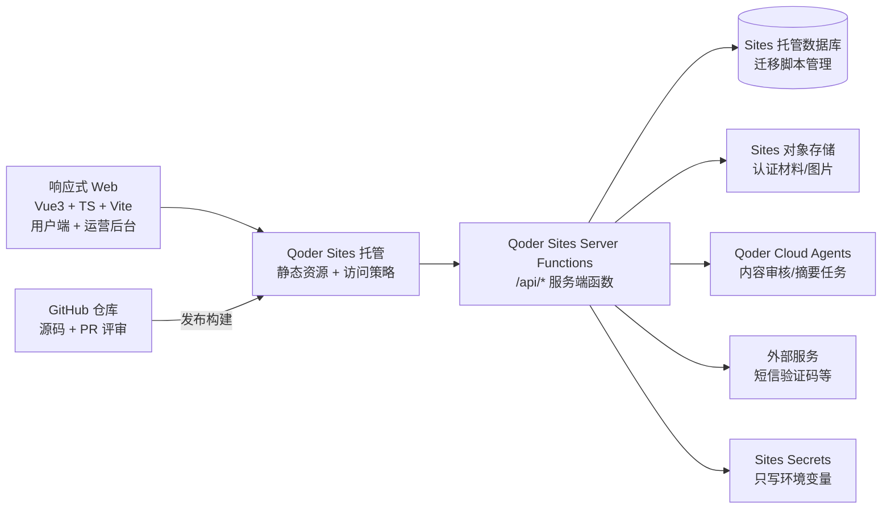
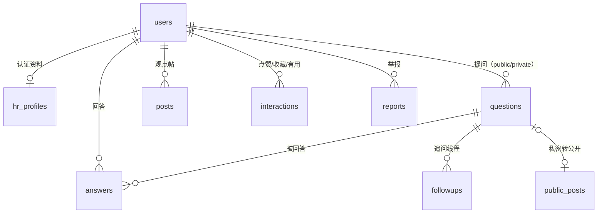
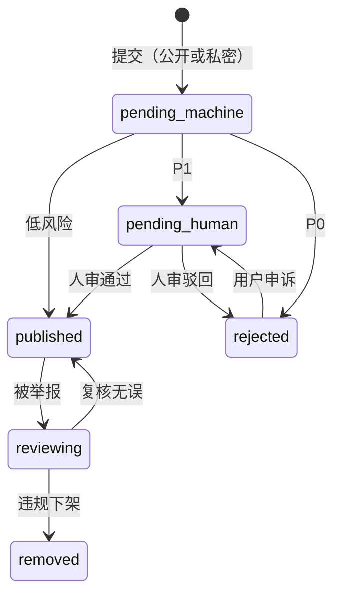
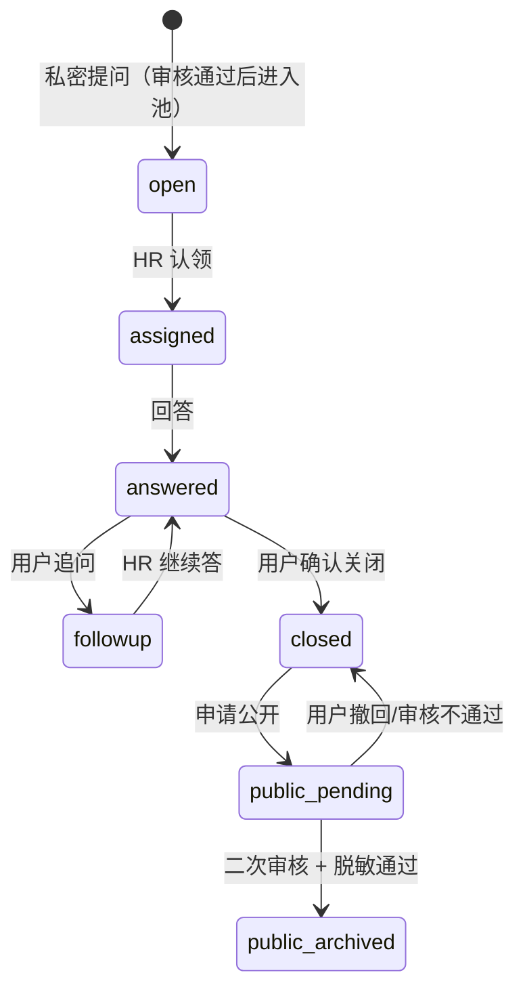

# 《职问桥》技术方案与架构设计（v0.3 · Qoder Sites 平台版）

> 项目代号：**CareerQ**　｜　配套文档：[`项目策划书-职问桥.md`](项目策划书-职问桥.md)、[`流程v2评估-私密问答与公开沉淀.md`](流程v2评估-私密问答与公开沉淀.md)
> 作者：**DeepSeek**（AI 协助）　｜　Web 修订：**Qorder**　｜　平台修订：**DeepSeek**，2026-11-14
> 状态：**v0.5 实施版**——2026-11-14 起**脱离比赛约束**，按长期项目推进（见第 18 节）
> 决策前提：① 采用**方案 C（公开提问 + 私密工单混合）** ② **Qoder Sites 强制已取消**，改为自建部署 ③ **用户本人负责 Spring Boot 后端与前后端连接，前端界面由队友负责（Vue3 + TypeScript）**

---

## 0. 结论先行（TL;DR）

1. **不自建服务器**。整体架构改为「**Qoder Sites 托管静态前端 + Sites Server Functions + Sites 托管数据库 + Sites 对象存储 + Qoder Cloud Agents**」。
2. 原 v0.2 中的 FastAPI / PostgreSQL / Redis / Caddy / Docker Compose **全部退出主线**，仅作为「若平台能力不足」的备选记录。
3. 前端仍为 **响应式 Web（Vue3 + TypeScript + Vite）**，与 v0.2 一致；用户端与运营后台同仓库、同站点发布。
4. 产品流程按**方案 C**：公开提问 与 私密工单二选一，两条路径**共用同一审核状态机**；私密问题关闭后由用户主动选择「脱敏公开」。
5. **平台硬约束要提前确认**：Free 套餐只支持静态部署、**不含数据库与存储**；Agent App 需付费套餐并使用平台用量额度。这是当前第一阻塞项。

## 1. 平台能力与约束（已核实）

来源：[Qoder CLI · Sites](https://docs.qoder.com/cli/sites)、[Qoder · Sites](https://docs.qoder.com/qoder/sites)。

| 能力 | 事实 | 对本项目的影响 |
|---|---|---|
| 建站与发布 | 从 Qoder 会话用 `@sites` 或模板创建，预览后发布；有 `prepare_site` / `publish_site` / `get_publish_status` | 交付物可直接是**可访问链接** |
| Agent App | 支持**数据库、Server Functions（服务端函数）、对象存储** | 替代自建后端，审核/鉴权逻辑写在服务端函数里 |
| 数据库 | 通过 Skills 管理迁移：`get_database_schema` / `create_database_migration` / `apply_database_migration` / `query_database_rows` | 表结构以迁移脚本管理，纳入 Git |
| 存储 | `upload_storage_file` / `list_storage_objects`，适合认证材料与图片 | HR 认证材料走私有存储 |
| AI 任务 | **Qoder Cloud Agents** 可被站点调用执行任务（处理数据、生成内容），结果可写入 DB/存储 | 内容审核可交给 Cloud Agent，无需自建模型服务 |
| 密钥 | `/sites` 面板维护环境变量（Secrets），**只写不可读** | 短信、第三方审核等密钥放这里，不进 Git |
| 分享与发布 | 访问策略：private / selected members / organization / public；公开需二次确认 | Demo 可先「指定成员可见」，验收后再 public |
| 用量与套餐 | 各套餐有使用限额；**Free 仅支持静态部署，不支持数据库和存储** | **必须使用付费套餐**才能做 Agent App |
| 合规 | 站点上「AI 生成内容」标识不可移除（中国《AI 生成合成内容标识办法》） | 产品文案须接受该标识，不设计「隐藏 AI 内容」 |
| 运维观测 | 站点有发布状态、日志（`get_function_logs`）、访问分析（`get_analytics`） | 审核积压与错误率可观测 |

> 注意：平台名 **Qoder**（阿里）与协作者模型名 **Qorder** 只差一个字母，沟通时不要混用。

## 2. 需求 → 实现映射（方案 C）

| 产品需求 | 平台实现 | 优先级 |
|---|---|---|
| 公开问答库、可检索 | DB 表 + 服务端函数分页/筛选 | P0 |
| 学生公开提问 | `questions(scope=public)` + 审核状态机 | P0 |
| **学生私密提问（新）** | `questions(scope=private)`，仅作者/指派 HR/运营可见 | P0 |
| **私密追问线程（新）** | `followups` 按 scope 区分，非实时 IM | P0 |
| **关闭后脱敏公开（新）** | 用户主动 `publish` → 二次审核 + 脱敏 → `public_posts` | P1 |
| HR 从问题池选答 / 认领私密单 | 公开池 + 私密待认领池两个查询 | P0 |
| 两种回答长度 | `answers.length_type` | P0 |
| 点赞 / 收藏 / 有用 | `interactions` 唯一约束 + 计数 | P0 |
| HR 观点帖 | `posts` + 同一审核链路 | P1 |
| 本周精选 | 运营精选标记 + 只读接口 | P1 |
| 举报与审核后台 | `reports` + 审核队列 + 人审工作台（同站点 `/admin`） | P0 |
| 身份认证 | 手机号 + 短信验证码；HR 人工核验 | P0 |
| 搜索与标签 | MVP：DB 模糊/标签查询；量大再引入检索 | P1 |
| 数据看板 | 聚合视图 + 定时函数 | P2 |

## 3. 总体架构



**说明**

- 前端只调用同站点 `/api/*`，不暴露数据库；所有写操作在服务端函数内做校验、限流与审核投递。
- 审核分两段：**同步轻量规则**（词库、联系方式正则）在服务端函数内完成；**重任务**（大模型/Cloud Agent 判定）异步执行并回写状态。
- 数据迁移脚本与业务代码一起进 GitHub，通过 PR 评审；发布动作由 Qoder Sites 完成。
- 运营后台与用户端同站点，用角色路由隔离；后台访问另加二次校验。

## 4. 技术选型

| 层 | 选型 | 理由 | 不选 |
|---|---|---|---|
| 前端 | Vue3 + TypeScript + Vite | 响应式适配、生态成熟、与 v0.2 一致，减少返工 | 不做小程序/独立 App（已确认 Web 路线） |
| 后端 | **Qoder Sites Server Functions（TypeScript）** | 与前端同语言、免运维、平台托管 | 不再自建 FastAPI/Docker（平台强制） |
| 数据库 | **Sites 托管数据库**（以平台迁移机制为准） | 免运维、与平台鉴权/部署打通 | 不自建 PostgreSQL/Redis |
| 存储 | Sites 对象存储 | 认证材料与图片，免运维 | 不自建 OSS 桶 |
| 异步任务 | Cloud Agents + 状态轮询 | 审核等重任务异步执行；**不做 WebSocket** | 不引入自建队列/Kafka |
| 认证 | 手机号 + 短信验证码，服务端会话 | 平台内自建会话（Cookie），不依赖第三方登录 | 不做微信/第三方 OAuth（非必需） |
| 观测 | Sites 日志 + 访问分析 + 自建审计表 | 平台原生可观测 | 不引入 Sentry 等外部监控（MVP） |
| 协同 | GitHub 仓库 + PR | 源码、文档、迁移脚本追溯 | 不把源码只存在平台里 |

## 5. 数据模型（方案 C）



| 表 | 关键字段 | 要点 |
|---|---|---|
| `users` | id, role(`student`/`hr`/`operator`/`admin`), phone_hash, phone_enc, phone_verified_at, nickname, school, major, grade, age_group, status | 手机号不存明文；角色 RBAC |
| `hr_profiles` | user_id, company_display, industry, position, verify_status, verify_material_ref, verified_at | 对外只露 `company_display` |
| `questions` | id, **scope(`public`/`private`)**, author_id, title, body, status, assigned_hr_id, first_answer_at, closed_at, answer_count, useful_count | `scope` 决定可见性；私密单仅作者/指派HR/运营可读 |
| `followups` | id, question_id, sender_id, sender_role, body, scope, status, created_at | 私密线程是**结构化列表**，不是实时聊天 |
| `answers` | id, question_id, author_id, body, length_type, status, like_count, useful_count | 私密回答同样过审核 |
| `public_posts` | id, original_question_id, title, question_body, hr_answer, anonymized, published_at, status | 由私密单**用户主动转换**生成 |
| `posts` | id, author_id, title, body, status, like_count | 观点帖 |
| `tags` / `question_tags` | id, name, slug, category / (question_id, tag_id) | 标签体系 |
| `interactions` | user_id, target_type, target_id, type(`like`/`favorite`/`useful`) | 唯一约束防重复 |
| `reports` | reporter_id, target_type, target_id, reason, status, handled_by | 举报处理 |
| `moderation_records` | target_type, target_id, stage(`machine`/`human`), model_version, risk_labels, decision, operator_id, note | **只增不改**，审计用 |
| `moderation_words` | word, category, action(`block`/`review`) | 运营可维护 |

设计原则：软删除 + 状态字段；计数冗余；时间服务端生成；正文纯文本（消灭 XSS）；**私密内容不因可见性降低而豁免审核**。

## 6. 状态机



私密单额外生命周期：



- 私密 → 公开**必须用户主动触发**，且经过「二次审核 + 脱敏检查」，不自动同步。
- 公开后保留原私密记录映射，支持撤回下架。

## 7. 服务端函数（API）设计

| 方法 | 路径 | 说明 | 权限 |
|---|---|---|---|
| POST | `/api/auth/sms-code` | 发送短信验证码（严格限流） | 公开 |
| POST | `/api/auth/login` | 手机号 + 验证码登录，签发会话 Cookie | 公开 |
| POST | `/api/auth/logout` | 注销 | 登录 |
| POST | `/api/auth/hr-verify` | 提交 HR 认证材料 | 登录 |
| GET | `/api/questions?scope=public` | 公开问题列表（标签/游标分页） | 公开 |
| POST | `/api/questions` | 提问（`scope=public/private`） | student |
| GET | `/api/questions/{id}` | 详情（私密单校验可见性） | 按 scope |
| GET | `/api/hr/question-pool` | 公开未答池 | hr |
| GET | `/api/hr/private-pool` | 私密待认领池（脱敏展示） | hr |
| POST | `/api/questions/{id}/answers` | 回答 | hr |
| POST | `/api/questions/{id}/followups` | 追问（公开或私密） | 可见者 |
| POST | `/api/questions/{id}/close` | 关闭归档 | 提问者 |
| POST | `/api/questions/{id}/publish` | 申请脱敏公开 | 提问者 |
| POST | `/api/interactions` | 点赞/收藏/有用 | 登录 |
| POST | `/api/reports` | 举报 | 登录 |
| GET | `/api/feed/highlights` | 精选 | 公开 |
| GET | `/api/admin/moderation/queue` | 审核队列 | operator |
| POST | `/api/admin/moderation/{id}/decide` | 通过/驳回/下架 | operator |
| GET | `/api/admin/metrics` | 回应率/时长/积压 | admin |

规范：游标分页；写接口幂等键；统一错误体 `{code,message,request_id}`；服务端函数内做限流（平台层 + 应用层）。

## 8. 审核系统（护城河，私密内容同样执行）

1. **规则层（同步）**：禁用词、联系方式（手机/微信/QQ）、招聘承诺、歧视词、URL 白名单。
2. **模型层（异步）**：调用 Qoder Cloud Agents 或外部内容安全服务，返回风险标签与置信度。
3. **人工层**：`/admin` 工作台，按「风险 × 等待时长」排序，批量操作。
4. **私密加强**：私密内容 P1 起步人审；运营查看私密内容写审计日志；公开转换再走一次审核 + 脱敏。

| 等级 | 判定 | 处理 |
|---|---|---|
| P0 | 涉政、色情、违法招聘、人身威胁 | 直接拒 + 留痕 |
| P1 | 高风险需语境判断（含全部私密内容） | 4 小时内人审 |
| P2 | 中风险/抽检 | 24 小时内人审 |
| P3 | 低风险 | 直发 + 抽样 |

## 9. 合规、隐私与平台标识

- 私密内容**不等于平台免责**：审核、举报、下架、留痕一视同仁；这是方案 C 成立的前提。
- 展示脱敏：HR 只显示「某互联网公司 HR」；公开沉淀默认隐去姓名、企业全称、学校、联系方式。
- 数据最小化：不采集身份证、不存简历、不做通讯录授权。
- 未成年人：`age_group` 标记，限制私密问答范围，提示监护人/学校合规要求。
- 免责声明：首页固定「个人项目，非学校官方；回答不构成招聘承诺」。
- **AI 内容标识**：Qoder Sites 对 AI 生成内容的标识不可移除，产品文案与 UI 需预留展示位，不做规避设计。
- 删除权：软删 + 置灰 + 公开内容下架；保留审计记录。

## 10. 安全

- 会话：高熵会话 ID + `HttpOnly`/`Secure`/`SameSite=Lax` Cookie；服务端只存哈希；支持注销与失效。
- CSRF：非 GET 请求校验 Token 与 `Origin`；CORS 仅允许站点域名。
- 短信：验证码只存哈希、5 分钟过期、限验证次数；IP + 手机号 + 设备限流，防轰炸。
- 越权：所有对象读写做 owner/角色校验，禁止仅凭前端传参。
- 防刷：限流 + 发帖验证码 + 内容去重（SimHash）。
- 密钥：全部放 Sites Secrets，不进 Git、不进前端。
- 审计：审核与后台操作日志保留 ≥180 天；平台日志（`get_function_logs`）用于排障。

## 11. 性能与容量

| 指标 | 目标 |
|---|---|
| API P95 | < 400 ms（含平台函数冷启动余量） |
| Web 手机端首屏 | < 2 s（静态资源 CDN + 骨架屏） |
| 可用性 | 依赖平台 SLA，MVP 目标 99%+ |

- 容量按平台套餐额度控制；冷启动阶段（1 万注册 / 500—1000 DAU / 日 200 条内容）足够。
- 审核是异步瓶颈：用状态轮询 + 队列告警，不阻塞用户写路径。

## 12. 发布与运维

- **源码与评审**：GitHub 仓库 + PR（沿用现行三方协作规范）；数据库迁移脚本同仓库管理。
- **发布**：Qoder Sites 发布流程（`prepare_site` → `publish_site` → `get_publish_status`），先「指定成员可见」，验收后切 public。
- **环境**：开发预览 / 正式发布两套；Secrets 在 `/sites` 面板维护。
- **观测**：Sites 访问分析 + 函数日志；自建 `moderation_records` 审计。
- **备份**：以平台能力为准（**待确认是否支持数据导出/备份**）；关键数据定期导出为 JSON 归档到仓库外。

## 13. 演进路线

| 阶段 | 技术动作 |
|---|---|
| MVP（1—4 周） | 平台建站 + 认证 + 公开/私密问答 + 审核状态机 + 人审后台 |
| 冷启动（5—8 周） | 指标看板、审核效率、私密→公开沉淀转化 |
| 内容沉淀（9—12 周） | 标签体系、精选、检索优化、专题页 |
| 扩展（13 周+） | 话题系统、收藏夹、推荐（可选） |

## 14. 风险与取舍

| 风险 | 应对 |
|---|---|
| 平台套餐不足（Free 无 DB/存储） | **第一阻塞项**：确认付费套餐与用量额度 |
| 平台能力边界（迁移/事务/全文检索） | MVP 用简单查询 + 标签；复杂需求再评估外部服务 |
| 私密内容审核压力 | 私密 P1 起步人审 + 机审分流 + 举报兜底 |
| 平台锁定 | 代码与迁移脚本进 GitHub；数据定期导出 |
| 审核积压 | 队列告警 + 批量操作 + 风险分级 |
| 过度设计 | 不引入自建服务器/队列/微服务 |

## 15. 待确认（阻塞项）

1. **Qoder Sites 账号套餐**：当前是否已具备数据库与存储能力（Free 不含）？比赛是否提供额度？
2. 比赛**截止时间**与**评审维度**。
3. 是否需要**公网可访问链接**（public）还是「指定成员可见」即可。
4. **短信验证码服务**：是否已有供应商/额度；否则先用「邀请码 + 邮箱」替代方案。
5. 是否允许调用**第三方大模型**做审核（或仅用平台 Cloud Agents）。
6. 数据导出/备份与自定义域名能力。

## 16. 分工建议

人类团队为王、季、李；AI 为协助方，不计入人类审查人数。

| 文件 / 模块 | 人类 owner | 人类审查者 | AI 协助方 | 状态 |
|---|---|---|---|---|
| `docs/技术方案-职问桥.md` | 待定 | 待定 | DeepSeek（v0.3 平台版） | 待评审 |
| 数据库迁移脚本 | 待认领 | 待定 | 建议 Codex | 待认领 |
| 前端（公开广场 + 私密工作区） | 待认领 | 待定 | 建议 Qorder | 待认领 |
| 审核后台 | 待认领 | 待定 | 待定 | 待认领 |
| Qoder Sites 发布与 Secrets | 待认领 | 待定 | 待定 | 待认领 |

> 原则：每个模块明确一名人类 owner 负责协调与审查；改动走独立分支 + PR；AI 同机编辑用 `.<name>_editing` 锁。

---

## 17. 后端实现修订 v0.4（Spring Boot，2026-11-14）

### 17.1 角色与边界（用户确认）

| 角色 | 负责 |
|---|---|
| **用户本人** | **Spring Boot 后端 + 前后端连接**（接口契约、联调、跨域、部署） |
| 队友 | 前端界面（框架待确认） |
| AI 协助 | 接口契约、数据模型、后端骨架代码、联调排错 |

### 17.2 技术栈

| 层 | 选型 | 说明 |
|---|---|---|
| **前端** | **Vue3 + TypeScript** | 队友负责；按 [`接口契约-职问桥.md`](接口契约-职问桥.md) 联调 |
| 语言/框架 | **Java 21 LTS + Spring Boot 3.x** | 用户既定 |
| Web | Spring Web（REST）+ Bean Validation | JSON API |
| 安全 | Spring Security | 会话或 JWT，见接口契约 §0 |
| 持久层 | MyBatis-Plus 或 Spring Data JPA | 建议 MyBatis-Plus：审核/分页查询可写原生 SQL |
| 数据库 | PostgreSQL 16（或 MySQL 8） | 二选一，按团队熟悉度；迁移用 Flyway |
| 缓存/限流 | Redis（可选） | MVP 可先用应用内限流 |
| 接口文档 | springdoc-openapi | 自动生成 `/swagger-ui` 与 OpenAPI JSON，前端联调依据 |
| 异步 | Spring `@Async` + 任务表；定时用 `@Scheduled` | MVP 不引入 MQ |
| 构建/部署 | Maven + Docker 镜像 | 部署到云服务器或容器平台 |

### 17.3 与 Qoder Sites 的关系（**第一阻塞项**）

- **若 Sites 仅托管前端静态资源**：前端 baseURL 指向 Spring Boot 域名；Sites 侧配置环境变量；后端独立部署并配置 CORS 白名单。
- **若比赛要求后端也必须运行在 Sites 内**（Server Functions）：**Spring Boot 无法直接托管**，需确认是否允许外部后端；若不允许，则 v0.4 方案需再次调整。
- 在确认前，按「Sites 托管前端 + Spring Boot 独立部署」推进，接口契约与数据模型不受影响。

### 17.4 前后端连接约定

1. 统一前缀 `/api/v1`；JSON + UTF-8；时间 ISO-8601。
2. **契约先行**：以 [`接口契约-职问桥.md`](接口契约-职问桥.md) + springdoc OpenAPI 为准；契约变更先改文档并在 PR 说明。
3. 本地：前端 dev server 代理 `/api` → `http://localhost:8080`；生产：同域反向代理（避免 CORS/Cookie 问题）。
4. 鉴权：**已定 Cookie 会话 + CSRF Token**；生产环境前后端同域反向代理，简化 Cookie 与 CORS。
5. 前端可先用契约文档的 Mock 数据独立开发，后端就绪后切换 baseURL。

### 17.5 后端包结构建议

```text
com.careerq
├── common/        # 统一响应、异常、分页、审计、限流
├── auth/          # 登录、会话、短信验证码
├── user/          # 用户与 Profile
├── hr/            # HR 认证、问题池、认领
├── question/      # 公开/私密问题、关闭、转公开
├── answer/        # 回答、追问
├── interaction/   # 点赞/收藏/有用
├── moderation/    # 词库、机审、人审队列
├── admin/         # 运营后台接口
└── metrics/       # 指标统计
```

### 17.6 部署拓扑（在 Sites 只托管前端的前提下）

```text
浏览器 → 前端静态站（Qoder Sites / CDN）
              │  /api/v1（HTTPS）
              ▼
        Spring Boot（Docker，云服务器）
              ├── PostgreSQL
              ├── Redis（可选）
              ├── 内容安全 API / 大模型
              └── 短信服务
```

密钥全部走环境变量/平台 Secrets，不进仓库。

### 17.7 与 v0.3 的差异

- 后端由「Qoder Sites Server Functions（TypeScript）」改为 **Spring Boot（Java）**。
- 数据库/状态机/审核/安全/合规等设计**与语言无关，继续有效**。
- 前端仍为响应式 Web；Qoder Sites 的角色收敛为「前端托管/发布 + 比赛提交」，待确认。

---

## 18. 实施修订 v0.5（脱离比赛约束，2026-11-14）

### 18.1 变更

- **Qoder Sites 强制取消**。部署改为自建：前端静态资源（Nginx/CDN 或任意静态托管）+ Spring Boot 后端 + PostgreSQL。
- 交付目标从「比赛技术方案」变为「**可运行 MVP + 接口契约 + 迁移脚本 + 部署说明**」。
- 技术栈不变：后端 **Spring Boot 3 + Java 21**（用户负责）；前端 **Vue3 + TypeScript**（队友负责）。

### 18.2 本机开发环境实测（2026-11-14）

| 工具 | 现状 | 结论 |
|---|---|---|
| Java | 11.0.32（Temurin） | ❌ **Spring Boot 3 需 17+**，需安装 JDK 21 |
| Maven | 3.9.15 | ✅ 可用 |
| Node / npm | v24.11.1 / 11.6.2 | ✅ 可用（前端） |
| Docker | 未安装 | ⚠️ 部署阶段再装 |
| PostgreSQL | 未安装 | ⚠️ 本地先用 H2（PostgreSQL 兼容模式），生产用 PostgreSQL |

### 18.3 本地开发约定

- `dev` profile：H2 内存库 + `MODE=PostgreSQL` 兼容模式；Flyway 迁移避免方言，保证 H2 与 PostgreSQL 都能跑。
- `prod` profile：PostgreSQL，Flyway 管理 schema。
- 前后端本地联调：前端 dev server 代理 `/api` → `http://localhost:8080`。
- 密钥走环境变量，`.env` 不入库。

### 18.4 里程碑

见 [`实施计划-职问桥.md`](实施计划-职问桥.md)。

