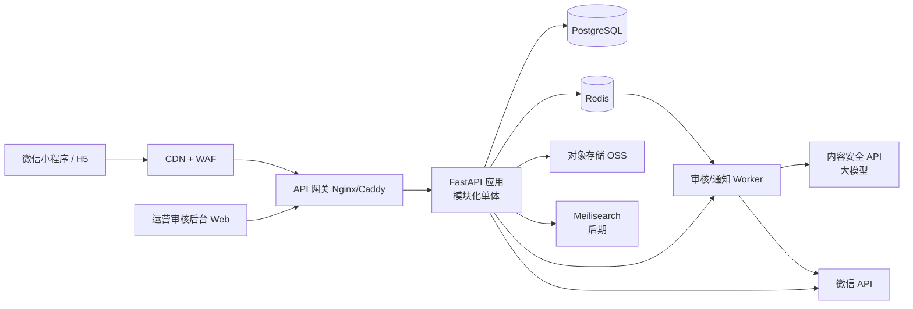
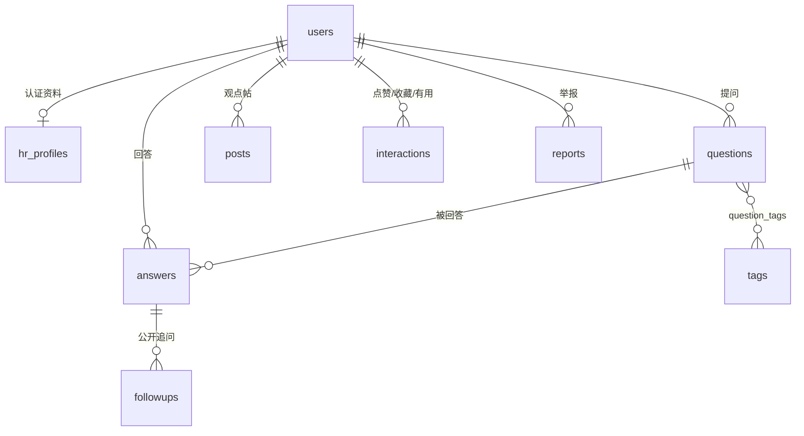
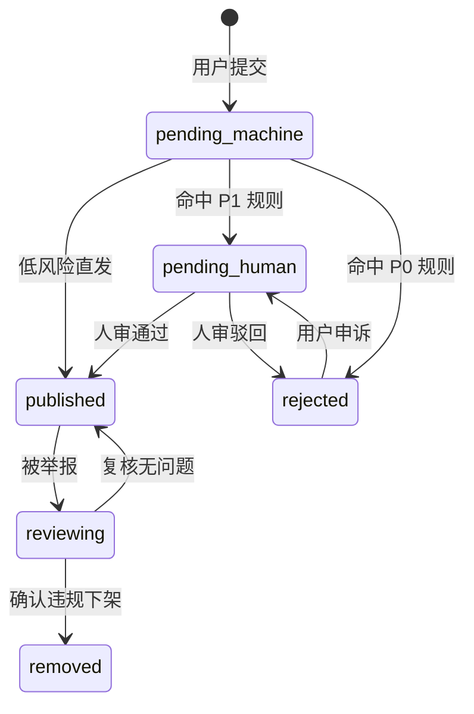

# 《职问桥》技术方案与架构设计

> 项目代号：**CareerQ**　｜　配套文档：[`项目策划书-职问桥.md`](项目策划书-职问桥.md)
> 作者：**DeepSeek**　｜　日期：2026-11-12　｜　状态：**草案 v0.1**（待 Codex / Qorder 评审）
> 范围：对齐策划书 MVP（第 1—4 周），给出可落地、低成本、可审核的技术架构。

---

## 0. 结论先行（TL;DR）

1. **模块化单体 + 轻量托管服务**，不上微服务、不上 K8s。团队小、周期 4 周，复杂度必须压到最低。
2. 技术栈：**微信小程序（TypeScript）+ FastAPI + PostgreSQL + Redis + 对象存储**；搜索先用 PG 全文，量大再上 Meilisearch。
3. **审核是系统一级公民**：所有 UGC 走「同步机审 → 异步人审 → 发布」状态机，全链路留痕、可申诉。
4. 产品明确不做 IM / 私信 → **全部 HTTP 异步请求，无长连接**，这是本方案最大的成本优势。
5. MVP 验收线：问题 48 小时内可有回应、审核 SLA 可控、单机可跑、每日可备份。

## 1. 需求 → 技术映射

| 产品需求（策划书） | 技术实现 | MVP 优先级 |
|---|---|---|
| 公开问答库、可检索 | 内容表 + 标签表 + 只读缓存/分页 | P0 |
| 学生提问 | 问题表 + 审核状态机 + 标签 | P0 |
| HR 从问题池选答 | 问题池查询（按标签/未答时间排序） | P0 |
| 两种回答长度 | `answers.length_type`：`one_liner` / `detailed` | P0 |
| 点赞 / 收藏 / 标记有用 | 互动表（唯一约束）+ 计数异步更新 | P0 |
| 公开追问 | 追问表（挂 answer，不做私聊） | P1 |
| HR 观点帖 | 观点帖表（与回答共用审核链路） | P1 |
| 本周精选 | 运营手动精选 + 只读精选接口 | P1 |
| 举报与审核后台 | 举报表 + 审核队列 + 人审工作台 | P0 |
| 身份认证 | 微信手机号 + HR 人工核验 | P0 |
| 搜索与标签 | MVP：PG 全文 + 标签；后期 Meilisearch | P1 |
| 数据看板（后续） | 只读聚合 + 定时任务 | P2 |

## 2. 总体架构

**说明**

- 应用层按模块分：`auth` / `question` / `answer` / `interaction` / `moderation` / `admin` / `feed`，单进程部署，模块间只通过服务层函数调用，**预留拆分接口**但不拆。
- 所有写操作先落库 → 投递异步任务（Redis Stream）→ Worker 处理审核、通知、计数。**写路径不阻塞在 AI 调用上**。
- 运营后台与 C 端共用一套 API，独立路由组 `/admin/*` + RBAC。

## 3. 技术选型与理由（含反例）

| 层 | 选型 | 理由 | 明确不选 |
|---|---|---|---|
| 客户端 | 微信小程序（原生 + TS） | 目标学生群体在微信；免安装、分享传播快 | 不做独立 App（审核/开发成本高） |
| 管理后台 | Vue3 + Element Plus | 运营审核工作台开发快 | 不用小程序做后台 |
| 后端 | **FastAPI (Python 3.12)** | AI 审核 SDK 生态最好；异步任务、类型校验、自动 OpenAPI 文档 | 不上 Java/Spring 微服务（人力不够） |
| 数据库 | **PostgreSQL 16** | 事务、JSONB、全文检索、成本低；审核与互动需要强一致 | 不用 MongoDB（关系查询与事务是刚需） |
| 缓存 | Redis 7 | 限流、热点缓存、互动计数、队列 | — |
| 队列 | Redis Stream（MVP） | 免运维；量起来再换 RabbitMQ | 不上 Kafka（过度设计） |
| 搜索 | PG `tsvector` + 标签（MVP）→ Meilisearch（>1 万条） | 先零成本，后平滑替换 | 不一开始就上 ES |
| 存储 | 云对象存储 OSS/COS | 图片/认证材料，直传 + 私有读 | 不把文件存服务器磁盘 |
| 部署 | Docker Compose 单机 + Caddy | 自动 HTTPS、一条命令起全栈 | 不上 K8s / Service Mesh |

## 4. 数据模型

核心表（字段为设计要点，非最终 DDL）：

| 表 | 关键字段 | 约束 / 索引 |
|---|---|---|
| `users` | id, role(`student`/`hr`/`operator`/`admin`), wechat_openid, phone_hash, phone_enc, nickname, school, major, grade, age_group, status, created_at | `openid` 唯一；`phone_hash` 索引；role+status 索引 |
| `hr_profiles` | user_id, company_display, industry, position, verify_status(`pending`/`verified`/`rejected`), verify_material_ref, verified_at | user_id 唯一；**对外只暴露 company_display** |
| `questions` | id, author_id, title, body, visibility, status, first_answer_at, answer_count, useful_count, created_at | `(status, created_at)` 索引；标签关联索引 |
| `answers` | id, question_id, author_id, body, length_type, status, like_count, useful_count, created_at | `(question_id, status)` 索引；`(author_id, created_at)` |
| `followups` | id, answer_id, author_id, body, status, created_at | `(answer_id, status)` |
| `posts` | id, author_id, title, body, status, like_count, created_at | `(status, created_at)` |
| `tags` / `question_tags` | id, name, slug, category, weight / (question_id, tag_id) | name 唯一；tag_id 反查索引 |
| `interactions` | id, user_id, target_type, target_id, type(`like`/`favorite`/`useful`), created_at | **唯一约束** (user, target_type, target_id, type) |
| `reports` | id, reporter_id, target_type, target_id, reason, status, handled_by, handled_at | `(status, created_at)` |
| `moderation_records` | id, target_type, target_id, stage(`machine`/`human`), model_version, risk_labels(jsonb), decision, operator_id, note, created_at | `(target_id, created_at)`；**只增不改** |
| `moderation_words` | id, word, category, action(`block`/`review`), updated_at | 热更新，运营可维护 |

设计原则：

- **软删除 + 状态字段**，不做物理删除（审核审计需要）。
- 计数（like_count 等）冗余存储，异步校准，避免每次 `count(*)`。
- 时间统一 `timestamptz`，服务端生成，不用客户端时间。
- 所有 UGC 正文 MVP 阶段**只允许纯文本 + 换行**，从根上消灭 XSS 与富文本注入。

## 5. 核心流程

### 5.1 内容发布与审核状态机（全站统一）

- 每次状态迁移写一条 `moderation_records`，记录阶段、模型版本、命中标签、决策人。
- **未发布内容不对外可见**；学生提问在发布前不占「待回答池」，避免垃圾问题污染供给。

### 5.2 HR 认证流程

提交材料（企业邮箱验证码 / 工牌 / 在职证明）→ 机审 OCR 校验 → 人工核验 → `verified`。对外展示 `company_display`（如「某互联网公司 HR」），**永不展示真实姓名**。

### 5.3 「有效回应」的计量

- 回答发布时若 `questions.first_answer_at` 为空则写入当前时间。
- 定时任务按小时统计：发布后 24h / 48h 是否 ≥1 条已发布回答 → 供指标看板与冷启动验收使用。

## 6. API 设计（REST，`/api/v1`）

| 方法 | 路径 | 说明 | 权限 |
|---|---|---|---|
| POST | `/auth/wechat-login` | 小程序 code 换登录态 | 公开 |
| POST | `/auth/phone-bind` | 手机号快速验证 | 登录用户 |
| POST | `/auth/hr-verify` | 提交 HR 认证材料 | 登录用户 |
| GET | `/questions` | 问题列表（标签/排序/游标分页） | 公开 |
| POST | `/questions` | 提问（进入审核） | student |
| GET | `/questions/{id}` | 问题详情 + 已发布回答 | 公开 |
| GET | `/hr/question-pool` | HR 问题池（未答优先） | hr |
| POST | `/questions/{id}/answers` | 回答问题（进入审核） | hr |
| POST | `/answers/{id}/followups` | 公开追问 | student |
| POST | `/interactions` | 点赞 / 收藏 / 有用 | 登录用户 |
| GET | `/posts` / `POST /posts` | 观点帖列表 / 发布 | 公开 / hr |
| GET | `/feed/highlights` | 本周精选 | 公开 |
| POST | `/reports` | 举报 | 登录用户 |
| GET | `/me/*` | 我的提问/收藏/回答 | 登录用户 |
| GET | `/admin/moderation/queue` | 审核队列（按风险×等待） | operator |
| POST | `/admin/moderation/{id}/decide` | 通过 / 驳回 / 下架 | operator |
| POST | `/admin/moderation/words` | 词库热更新 | operator |
| GET | `/admin/metrics` | 回应率 / 时长 / 积压 | admin |

**接口规范**

- 游标分页（`cursor` + `limit`），不用 offset 翻深页。
- 写接口支持 `Idempotency-Key` 头，防重复提交（尤其提问）。
- 统一错误体：`{code, message, request_id}`；`request_id` 贯穿日志。
- 限流：公开读 60 req/min/IP，写 10 req/min/用户，登录 5 req/min/IP。

## 7. 审核系统设计（本项目的护城河）

**分层过滤**

1. **词库**：精确/变体匹配（禁用词、联系方式、招聘承诺、歧视词），命中 P0 → 直接拒，命中 P1 → 转人工。
2. **内容安全 API / 大模型**：政治敏感、色情、辱骂、广告导流，返回风险标签与置信度。
3. **规则**：持续联系方式（手机号/微信/QQ 正则）、URL 白名单、疑似招聘话术。
4. **人工**：工作台按「风险等级 × 等待时长」排序，支持一键通过/驳回/编辑提示语。

**风险分级与 SLA**

| 等级 | 判定 | 处理 |
|---|---|---|
| P0 | 涉政、色情、违法招聘、人身威胁 | 机审直接拒 + 记录，不进队列 |
| P1 | 高风险但需语境判断 | 4 小时内人审 |
| P2 | 中风险/需抽检 | 24 小时内人审 |
| P3 | 低风险 | 机审直发 + 抽样复核 |

**可审计与可申诉**

- `moderation_records` 只增不改，记录模型版本、命中标签、决策人、理由。
- 被驳回内容对作者展示「原因分类 + 申诉入口」，申诉进 P1 队列。
- 被举报内容回收进 `reviewing`，复核结果同样留痕。

**审核效率**

- 队列支持批量操作、快捷键、相似内容聚合。
- 词库运营可自助增删（带操作审计）。
- 每周输出「误伤率 / 漏放率 / 平均审核时长」三项，作为运营指标。

## 8. 认证、隐私与合规技术措施

| 要求 | 技术实现 |
|---|---|
| 学生实名（手机号） | 微信 `getPhoneNumber` 授权；**不存明文**，存 `phone_hash` + 加密字段 |
| HR 身份 | 企业邮箱验证码 / 工牌 OCR / 在职证明，人工核验 |
| 展示脱敏 | 只展示 `company_display` + `industry` + `position`，禁止真实姓名与联系方式 |
| 数据最小化 | 不采集身份证、不存简历、不做通讯录授权 |
| 未成年人 | `age_group` 标记，限制引流类内容；不设私聊即天然降低风险 |
| 免责声明 | 首页与详情页固定展示「个人项目，非学校官方；回答不构成招聘承诺」 |
| 删除权 | 用户可申请删除自己的内容，实际执行软删 + 内容置灰 |
| 日志 | 访问日志脱敏，手机号/OpenID 不入明文日志 |

## 9. 安全设计

- **认证授权**：JWT（access 2h / refresh 30d），角色 RBAC（student / hr / operator / admin），后台强制二次验证。
- **越权**：所有对象读写做 owner 校验，禁止仅凭前端传参。
- **防刷**：IP + 设备 + 用户三维限流；发帖验证码；内容 SimHash 去重（防刷屏/搬运）。
- **注入**：ORM 参数化查询；纯文本正文；URL 白名单。
- **文件**：认证材料私有读 + 短时签名 URL，不公开桶。
- **数据**：每日全量备份 + WAL 归档；管理操作审计日志保留 180 天。

## 10. 性能与容量（MVP 估算）

| 指标 | 目标 |
|---|---|
| API P95 延迟 | < 300 ms |
| 小程序首屏 | < 1.5 s（列表接口 + 骨架屏） |
| 可用性 | 99.5%（MVP 可接受） |
| 容量假设 | 1 万注册 / 500—1000 DAU / 日新增内容 200 条 |

- 单机 2C4G 足以支撑；瓶颈会先出现在 AI 审核调用，用队列削峰。
- 缓存：精选与标签页 CDN 60s；问题详情 Redis 30s；互动计数异步落库。
- 数据库连接池 + 慢查询阈值告警（>200ms）。

## 11. 部署与运维

- **环境**：dev / staging / prod，同一套 Compose，配置走环境变量（密钥不入库、不入 Git）。
- **CI/CD**：GitHub Actions（`lint` → `test`（PG 容器）→ `build` → 部署脚本）。仓库已在 GitHub，天然衔接。
- **监控**：Sentry（异常）+ 云监控（CPU/内存/延迟/错误率）+ 审核队列积压告警（>50 条或最老 >4h）。
- **备份**：每日全量，RPO 24h / RTO 4h（MVP 目标）。
- **成本**：2C4G 云服务器约 100—200 元/月；OSS 与 AI 审核按量，冷启动阶段可忽略。

## 12. 演进路线（与策划书对齐）

| 阶段 | 技术动作 |
|---|---|
| MVP（1—4 周） | 本方案全部 P0；审核状态机 + 工作台；基础埋点 |
| 冷启动（5—8 周） | 数据看板、审核效率工具、指标告警、内容去重 |
| 内容沉淀（9—12 周） | Meilisearch 接入、问答合集、专题页、SEO |
| 扩展（13 周+） | 话题系统、收藏夹、推荐（可选）、多端 |

## 13. 风险与取舍

| 风险 | 应对 |
|---|---|
| AI 审核误伤，打击 HR 供给 | 人审兜底 + 申诉 + 误伤率监控；P1 才拦，P3 直发 |
| 审核积压导致 48h 回应落空 | 队列告警 + 批量操作 + 风险分级；必要时先发后审（需评估合规） |
| 单机故障 | 每日备份 + 一键重建脚本；数据库与 OSS 分离 |
| 过度设计拖慢 MVP | 明确不上一堆中间件；先跑通「有回应」再扩 |
| 合规变化 | 词库与审核规则可配置，不硬编码在代码里 |

## 14. 团队分工建议（按文件边界）

人类开发团队为王、季、李，具体分工暂未确定。下表中的 AI 仅表示建议协助方，不代表人类负责人或 PR 审查者。

| 文件 / 模块 | 人类 owner | 人类审查者 | AI 协助方 | 状态 |
|---|---|---|---|---|
| `docs/技术方案-职问桥.md` | 待定 | 待定 | DeepSeek | 草案待评审 |
| 数据模型 SQL / 迁移脚本 | 待认领 | 待定 | 建议 Codex | 待认领 |
| 小程序前端（提问/回答/互动） | 待认领 | 待定 | 建议 Qorder | 待认领 |
| 运营审核后台 | 待认领 | 待定 | 待定 | 待认领 |
| 技术方案评审意见 | 待定 | 待定 | Codex / Qorder | 在 `shared/` 回复 |

> 分工原则：每个文件或模块明确一名人类 owner 负责协调与审查；其他成员可通过独立分支和 PR 参与。AI 同机编辑时使用 `.<name>_editing` 锁，该锁不替代跨成员的 Issue、PR 与 owner 协调。

## 15. 待用户确认（阻塞项）

1. 比赛**截止时间**与**评审维度**（创新性 / 可行性 / 技术完成度 / 社会价值）。
2. 是否需要**真实部署可访问**的 Demo，还是架构文档 + 原型即可。
3. 是否有云账号 / 域名 / 小程序 AppID；没有则 Demo 用 H5 替代。
4. 是否允许调用第三方大模型做审核（成本与合规）。
